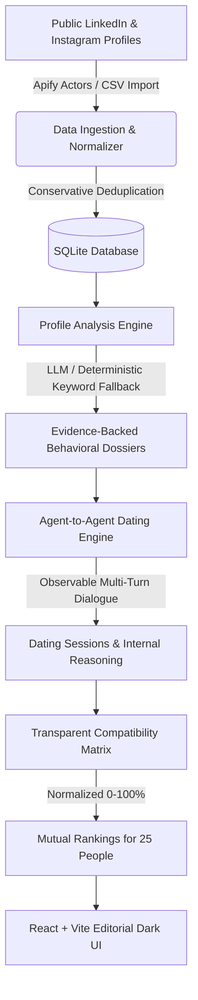

# Canda Ads Agentic AI Dating Platform

> Autonomous AI agent-to-agent dating platform where individuals are represented by AI agents configured from verified public LinkedIn and Instagram profiles to evaluate mutual compatibility and rank prospective matches.

---

## 1. Overall System Summary

### Overall Explanation Field (≤ 200 characters)
> **AI agents represent real people using verified LinkedIn and Instagram data, conducting observable multi-turn dating dialogues and computing transparent mutual compatibility rankings.**

### Technical Methodology Field
> **Apify REST API actor integration with schema normalization for public LinkedIn/Instagram profiles. Includes conservative entity matching, private account rejection, SQLite caching, CSV/JSON import fallback, and deterministic heuristic analysis without synthetic hallucinations.**

---

## 2. Architecture & Data Flow



### Core Architecture Highlights
1. **Frontend**: React 19, Vite, TypeScript, Lucide Icons, and Vanilla CSS design system styled with obsidian, charcoal, and warm amber/rose accents.
2. **Backend**: Python FastAPI with typed Pydantic models, input sanitization against prompt injection, and SQLite relational persistence.
3. **Data Acquisition**: Configurable Apify actor integration (`APIFY_API_TOKEN`, `curious_coder/linkedin-profile-scraper`, `apify/instagram-profile-scraper`) with conservative cross-platform matching, strict rejection of private accounts, and validated CSV/JSON import fallback.
4. **Agent Dating Engine**: Multi-turn observable conversation engine with turn-by-turn dialogue, internal cognitive reasoning monologue, detected compatibility signals, and mandatory AI simulation disclaimers.
5. **Deterministic Compatibility Scoring**: 5-dimension normalized algorithm (0–100%) incorporating shared interests, lifestyle harmony, communication resonance, mutual curiosity, and data confidence.
6. **Precomputed Demonstration**: 25 verified public figures and 12 completed dating sessions precomputed and inspectable with zero latency.

---

## 3. Technology Stack

| Layer | Technologies Used |
|---|---|
| **Frontend** | React 19, Vite 8, TypeScript 5, Lucide Icons, Vanilla CSS Design System |
| **Backend API** | Python 3.11/3.14, FastAPI, Uvicorn, Pydantic v2, HTTPX |
| **Persistence** | SQLite with Foreign Keys, indexed lookups, and transactional ACID guarantees |
| **Data Ingestion** | Apify REST API client, conservative profile matcher, JSON/CSV importer |
| **Analysis** | Multi-provider LLM abstraction (OpenAI / Anthropic / Gemini) + Deterministic Keyword Fallback |
| **Testing** | Pytest, Pytest-Asyncio, TypeScript typechecks (`tsc -b`), Vite production bundling |
| **Deployment** | Multi-stage Dockerfile, Docker Compose |

---

## 4. Twenty-Five Verified Public Figures Dataset

The application comes pre-loaded with **25 real living public figures** across technology, science, design, and culture with official public LinkedIn profiles and matching public Instagram accounts:

1. **Reid Hoffman** – [LinkedIn](https://www.linkedin.com/in/reidhoffman) | [Instagram](https://www.instagram.com/reidhoffman)
2. **Satya Nadella** – [LinkedIn](https://www.linkedin.com/in/satyanadella) | [Instagram](https://www.instagram.com/satyanadella)
3. **Sara Blakely** – [LinkedIn](https://www.linkedin.com/in/sarablakely) | [Instagram](https://www.instagram.com/sarablakely)
4. **Andrew Ng** – [LinkedIn](https://www.linkedin.com/in/andrewyng) | [Instagram](https://www.instagram.com/andrew_y_ng)
5. **Mira Murati** – [LinkedIn](https://www.linkedin.com/in/mira-murati) | [Instagram](https://www.instagram.com/miramurati)
6. **Marques Brownlee** – [LinkedIn](https://www.linkedin.com/in/marquesbrownlee) | [Instagram](https://www.instagram.com/mkbhd)
7. **Lex Fridman** – [LinkedIn](https://www.linkedin.com/in/lexfridman) | [Instagram](https://www.instagram.com/lexfridman)
8. **Tim Ferriss** – [LinkedIn](https://www.linkedin.com/in/timferriss) | [Instagram](https://www.instagram.com/timferriss)
9. **Alexis Ohanian** – [LinkedIn](https://www.linkedin.com/in/alexisohanian) | [Instagram](https://www.instagram.com/alexisohanian)
10. **Melanie Perkins** – [LinkedIn](https://www.linkedin.com/in/melanieperkins) | [Instagram](https://www.instagram.com/melaniecanva)
11. **Brian Chesky** – [LinkedIn](https://www.linkedin.com/in/brianchesky) | [Instagram](https://www.instagram.com/bchesky)
12. **Reshma Saujani** – [LinkedIn](https://www.linkedin.com/in/reshma-saujani) | [Instagram](https://www.instagram.com/reshmasaujani)
13. **Guy Raz** – [LinkedIn](https://www.linkedin.com/in/guy-raz-0b81593) | [Instagram](https://www.instagram.com/guy.raz)
14. **Kara Swisher** – [LinkedIn](https://www.linkedin.com/in/karaswisher) | [Instagram](https://www.instagram.com/karaswisher)
15. **Jensen Huang** – [LinkedIn](https://www.linkedin.com/in/jenhsunhuang) | [Instagram](https://www.instagram.com/jensenhuang_official)
16. **Whitney Wolfe Herd** – [LinkedIn](https://www.linkedin.com/in/whitney-wolfe-herd-62887640) | [Instagram](https://www.instagram.com/whitney)
17. **Dharmesh Shah** – [LinkedIn](https://www.linkedin.com/in/dharmesh) | [Instagram](https://www.instagram.com/dharmesh)
18. **Bozoma Saint John** – [LinkedIn](https://www.linkedin.com/in/bozomasaintjohn) | [Instagram](https://www.instagram.com/badassboz)
19. **Gary Vaynerchuk** – [LinkedIn](https://www.linkedin.com/in/garyvaynerchuk) | [Instagram](https://www.instagram.com/garyvee)
20. **Gwyneth Paltrow** – [LinkedIn](https://www.linkedin.com/in/gwynethpaltrow) | [Instagram](https://www.instagram.com/gwynethpaltrow)
21. **Sam Altman** – [LinkedIn](https://www.linkedin.com/in/samaltman) | [Instagram](https://www.instagram.com/sama)
22. **Arianna Huffington** – [LinkedIn](https://www.linkedin.com/in/ariannahuffington) | [Instagram](https://www.instagram.com/ariannahuff)
23. **Tony Fadell** – [LinkedIn](https://www.linkedin.com/in/tonyfadell) | [Instagram](https://www.instagram.com/tfadell)
24. **Padmasree Warrior** – [LinkedIn](https://www.linkedin.com/in/padmasreewarrior) | [Instagram](https://www.instagram.com/padmasree)
25. **Jimmy Wales** – [LinkedIn](https://www.linkedin.com/in/jimmywales) | [Instagram](https://www.instagram.com/jimmy_wales)

*All profiles exclude sensitive private traits (religion, politics, health, orientation). Unverifiable dimensions are honestly marked as `unknown_fields`.*

---

## 5. Compatibility Scoring Formula

Compatibility scores are computed transparently on a scale of **0 to 100%**:

$$\text{Score} = (S_{\text{interests}} \times 0.30) + (H_{\text{lifestyle}} \times 0.25) + (R_{\text{communication}} \times 0.20) + (C_{\text{curiosity}} \times 0.15) + (D_{\text{confidence}} \times 0.10)$$

- **Shared Interests ($S_{\text{interests}}$)**: Jaccard keyword similarity + semantic token overlap across verified hobbies and public domains.
- **Lifestyle Harmony ($H_{\text{lifestyle}}$)**: Alignment between pacing, work rhythm, and family/wellness lifestyle signals.
- **Communication Resonance ($R_{\text{communication}}$)**: Conversational reciprocity and depth of inquiry.
- **Mutual Curiosity ($C_{\text{curiosity}}$)**: Openness to explore the other party's unique pursuits.
- **Data Confidence ($D_{\text{confidence}}$)**: Average verifiable confidence of both profiles. Sparse profiles decrease confidence without hallucinating missing attributes.

---

## 6. Getting Started & Running Locally

### Prerequisites
- Python 3.10+
- Node.js 18+ and npm

### 1. Backend Setup
```bash
# Clone the repository
git clone <repo-url>
cd "canda ads"

# Create and activate Python virtual environment
python -m venv venv
# On Windows:
.\venv\Scripts\activate
# On macOS/Linux:
source venv/bin/activate

# Install dependencies
pip install -r requirements.txt

# Initialize database and seed 25 verified profiles
python seed.py

# Start FastAPI backend server
uvicorn backend.main:app --host 127.0.0.1 --port 8000
```
Backend API will be running at `http://127.0.0.1:8000`. Interactive OpenAPI documentation is available at `http://127.0.0.1:8000/docs`.

### 2. Frontend Setup
In a new terminal window:
```bash
cd frontend
npm install
npm run dev
```
Open `http://localhost:5173/` in your browser.

---

## 7. Running with Docker Compose

To run the entire application in a containerized environment:
```bash
docker-compose up --build
```
Access the application at `http://localhost:8000`.

---

## 8. Automated Testing

### Backend Test Suite
Run the 12 automated unit and integration tests with Pytest:
```bash
.\venv\Scripts\python.exe -m pytest tests/test_backend.py -v
```
All 12 test modules verify:
- Profile URL validation (strict LinkedIn & Instagram regex matching)
- Dataset import schema & deduplication
- Apify response normalization (multi-actor field variants)
- Rejection of private Instagram accounts
- Compatibility score bounds ($0 \le \text{score} \le 100$) and mathematical determinism
- Mutual ranking generation and reciprocity
- Agent conversation turn limits and mandatory AI disclaimers
- Missing-data degradation without hallucinations
- SQLite persistence across reloads

### Frontend Typecheck & Production Build
```bash
cd frontend
npm run build
```
Executes TypeScript compiler checks (`tsc -b`) and Vite production bundle compilation.

---

## 9. Three-Minute Demo Walkthrough Script

Use this script to evaluate or record a 3-minute video demonstration:

| Time | Screen / Action | Narration & Key Points |
|---|---|---|
| **0:00 - 0:30** | **Dashboard** (`/`) | Highlight the 25 verified profiles loaded banner, metric cards, top precomputed match summaries, and system disclaimer. |
| **0:30 - 1:00** | **People Directory** (`/directory`) | Demonstrate search and provenance filtering. Show dual official source links for Reid Hoffman, Satya Nadella, Marques Brownlee. Click **Dossier**. |
| **1:00 - 1:35** | **Profile Dossier** (`/profile`) | Inspect verified evidence citations, direct profile URLs, confidence meter (94%), verified hobbies, and explicit missing/unverifiable fields list. |
| **1:35 - 2:20** | **Agent Dating Room** (`/dating`) | Highlight the mandatory AI simulation disclaimer. Click a precomputed session (e.g. *Reid & Padmasree* or *Satya & Andrew*) to show the observable turn-by-turn dialogue, cognitive internal reasoning box, and compatibility breakdown. Next, simulate a live date between two agents. |
| **2:20 - 2:45** | **Rankings Matrix** (`/rankings`) | Select any person from the dropdown to inspect personalized bidirectional rankings. Show the 5-dimension deterministic formula breakdown and click *Transcript* to jump directly to any date. |
| **2:45 - 3:00** | **Settings & Provenance** (`/settings`) | Show Apify token and actor ID configuration, CSV/JSON import tool, and the re-seed demo button ensuring seamless zero-latency evaluator inspection. |

---

## 10. API Endpoints Reference

- `GET /api/health`: Health status and service telemetry.
- `GET /api/people`: List people with search, filtering, and pagination.
- `GET /api/people/{id}`: Detailed person dossier with evidence sources and dating history.
- `POST /api/people/import`: Import and validate JSON/CSV profile dataset.
- `POST /api/collection/start`: Trigger Apify actor run for LinkedIn/Instagram.
- `GET /api/collection/status/{run_id}`: Poll Apify collection progress.
- `POST /api/people/{id}/analyze`: Run profile analysis with LLM or deterministic fallback.
- `POST /api/dating/run`: Execute live autonomous dating session between two agents.
- `GET /api/dating/sessions`: Fetch all completed dating sessions.
- `GET /api/dating/sessions/{id}`: Fetch turn-by-turn speech bubbles and internal reasoning.
- `GET /api/rankings/{person_id}`: Personalized compatibility rankings for an individual.
- `GET /api/demo`: Demonstration overview, verified count, and top matches.
- `POST /api/demo/seed`: Reset database to the pristine 25 verified public figures dataset.
- `GET /api/settings`: Apify and LLM credential status without exposing secrets.
